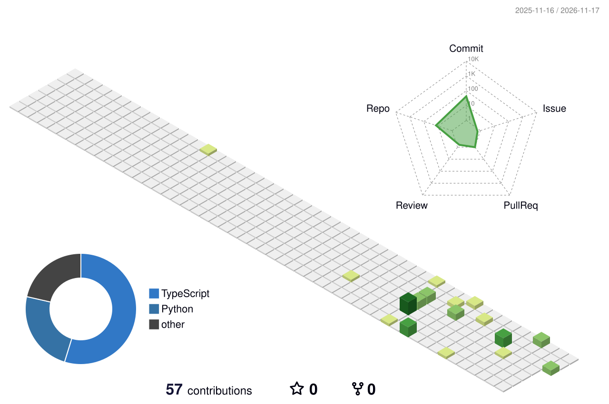

  

  
  
  
  

📍 Vellore, Tamil Nadu, India

---

## About Me

Integrated M.Tech Software Engineering student at Vellore Institute of Technology (VIT), expected to graduate in 2027. I am targeting Graduate Software Engineer and entry-level Software Developer roles.

I build backend and full-stack applications using Python, FastAPI, React and TypeScript. My work includes API development, database integration, applied AI/ML systems and automated testing. I value clear architecture, measurable evaluation and honest reporting of implementation status.

---

## Technical Skills

<strong>Languages</strong>

  

<strong>Backend & Databases</strong>

  

<strong>Frontend</strong>

  

<strong>AI/ML & Developer Tools</strong>

  

| Category | Technologies |
|---|---|
| **Languages** | Python · TypeScript · JavaScript · SQL |
| **Backend** | FastAPI · REST APIs · Pydantic · SQLAlchemy · SQLite · Supabase |
| **Frontend** | React · Next.js · Vite · HTML/CSS · Tailwind CSS |
| **AI/ML** | Retrieval-Augmented Generation (RAG) · FAISS · scikit-learn · Random Forest |
| **Testing** | pytest · Vitest |
| **Tools** | Git · GitHub · Vercel · Streamlit · PyMuPDF · Cloudinary |
| **Fundamentals** | Data Structures & Algorithms · OOP · DBMS · Operating Systems · Computer Networks |

---

## Featured Projects

### 1. AgentSentinel — Runtime Governance for AI Agents

  
  
  
  
  

*Individual M.Tech dissertation at VIT Vellore · Solo-implemented*

A 12-module runtime governance system that intercepts AI-agent tool calls before execution and enforces fail-closed handling for `BLOCK` verdicts.

- Pre-execution interception and action normalization.
- Behavioral tracking and 22-feature extraction.
- Random Forest risk assessment and task-context authorization.
- Policy fusion and SQLite/SQLAlchemy audit persistence.
- FastAPI backend and React/TypeScript observability dashboard.

**Test suite:** 523 documented pytest tests.

**Held-out evaluation:** 250 samples from 1,000 ATBench trajectories.

| Metric | Result |
|---|---:|
| Accuracy | 72.40% |
| Precision | 78.95% |
| Recall | 60.48% |
| F1-score | 68.49% |
| ROC-AUC | 0.7782 |

*These are internal, single-dataset evaluation results, not an independently benchmarked result.*

[View repository →](https://github.com/santhoshraghuraman/AgentSentinel)

---

### 2. SciPilot — Scientific Document Research Assistant

  
  
  
  

*AI internship project · AICTE–Edunet Foundation (IBM SkillsBuild)*

A seven-stage research pipeline for scientific PDFs covering planning, retrieval, synthesis, verification, citation generation, reporting and session memory.

- PDF extraction and overlapping text chunking with PyMuPDF.
- FAISS retrieval with Maximal Marginal Relevance (MMR) re-ranking.
- Citation coverage and n-gram grounding verification.
- Confidence scoring and APA/IEEE citation formatting.
- Markdown/PDF report export through a five-tab Streamlit interface.

**Test suite:** 378 documented pytest tests.

*The project includes a local demo mode. IBM watsonx.ai integration is implemented but has not been live-validated; the local demo should not be described as live IBM inference.*

[View repository →](https://github.com/santhoshraghuraman/SciPilot)

---

### 3. Adaptive Layout Engine

  
  
  
  

A framework-agnostic TypeScript layout engine with 10 modules and no React/DOM dependencies.

- Generates constraint-valid layouts across six advertising surfaces.
- Uses constraint validation and weighted candidate ranking.
- Implements binary-search text fitting.

**Test suite:** 61 documented Vitest tests.

**Benchmark:** 0.110 ms mean and 0.065 ms median (p50) computation time across 900 runs, as documented in the repository benchmark.

[View repository →](https://github.com/santhoshraghuraman/flamai-adaptive-layout-engine)

---

### 4. Reliable Vision — Lead Management CRM (Milestone 1)

  
  
  

*Client project · First milestone*

A lead-management foundation built with Next.js, TypeScript and Supabase.

- Excel/CSV lead upload, preview and validation.
- Duplicate-phone detection within an upload and against existing Supabase records.
- Import of valid leads and searchable lead records.
- Lead detail views and dashboard statistics.

*Milestone 1 scope only: WhatsApp messaging, n8n automation, Gemini AI scoring, campaign management and related integrations are listed as future work in the repository documentation; they are not represented here as implemented features.*

[View repository →](https://github.com/santhoshraghuraman/reliable-vision-automation)

---

## Additional Projects

### Nearva — Local Service Discovery Platform

*Primary developer*

A hyperlocal service-discovery platform connecting users with nearby workers. The repository documents worker registration, admin approval, service filtering and map-based discovery using FastAPI, Supabase, Leaflet.js and OpenStreetMap.

[View repository →](https://github.com/santhoshraghuraman/Nearva)

### RedactIQ — Document PII Detection & Redaction

*Team academic project*

A document-sanitization project combining regular-expression patterns and named-entity recognition to identify and redact sensitive information in PDF, DOCX and TXT documents. Project evaluation figures are reported in the team's documentation and have not been independently reproduced here.

[View repository →](https://github.com/santhoshraghuraman/RedactIQ)

### SecureIt — Image/Video Steganography & Speech-to-Text

*Team academic project*

An academic project exploring LSB-based image/video steganography and Gemini-powered speech-to-text, with media-quality evaluation concepts including PSNR, MSE and SSIM.

*The public repository currently provides project documentation; it states that the original implementation source is not included.*

[View repository →](https://github.com/santhoshraghuraman/SecureIt)

---

## Experience

### AI Intern — AICTE–Edunet Foundation (IBM SkillsBuild)

*June 2026 – July 2026*

Developed SciPilot, a scientific-document research assistant with a seven-stage RAG workflow, retrieval, grounding verification and citation generation.

### Freelance Software Developer

*December 2024 – Present*

- Delivered 5+ freelance web projects across business and portfolio domains.
- Built and deployed a document-submission workflow with an admin dashboard for a consulting client.
- Used FastAPI, Supabase and Cloudinary with input and file validation.

---

## Patent Application

**Co-inventor (fourth listed)** — Published Indian patent application **IN202641067193 A1**.

*System and Method for Victim-Side Detection and Attribution of SMS and Call Bombing Attacks.*

Filed on 29 May 2026 at Vellore Institute of Technology.

**Published application — not a granted patent.**

---

## Certifications

- Oracle Cloud Infrastructure 2025 Certified AI Foundations Associate
- Supervised Machine Learning — Stanford Online & DeepLearning.AI
- Python for Data Science — IBM

---

## 3D Contribution Calendar

  <picture>
    <source media="(prefers-color-scheme: dark)" srcset="./profile-3d-contrib/profile-night-green.svg" />
    <source media="(prefers-color-scheme: light)" srcset="./profile-3d-contrib/profile-green-animate.svg" />
    
  </picture>

<em>Contribution visualization generated from GitHub activity.</em>

